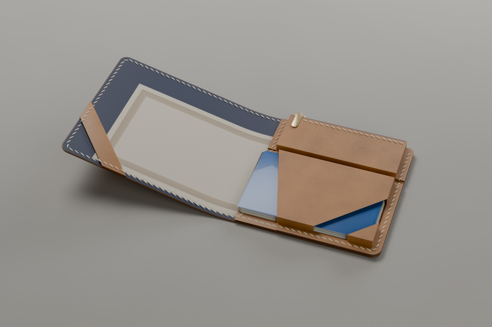
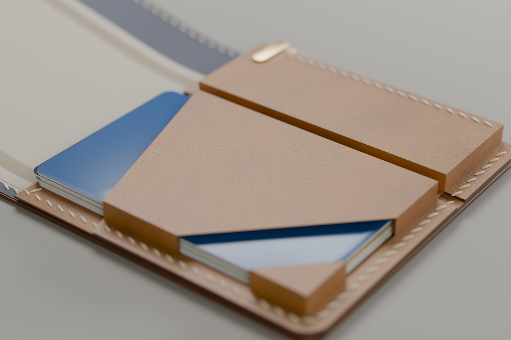
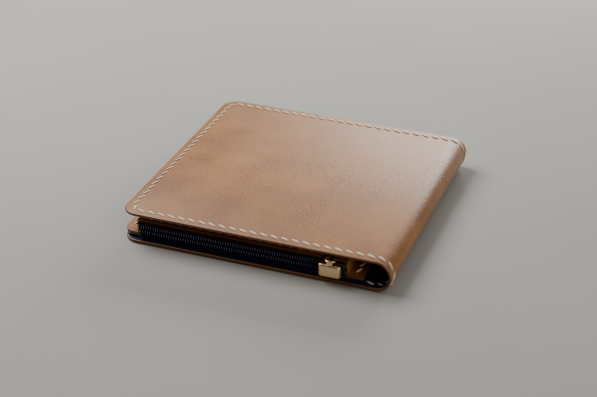
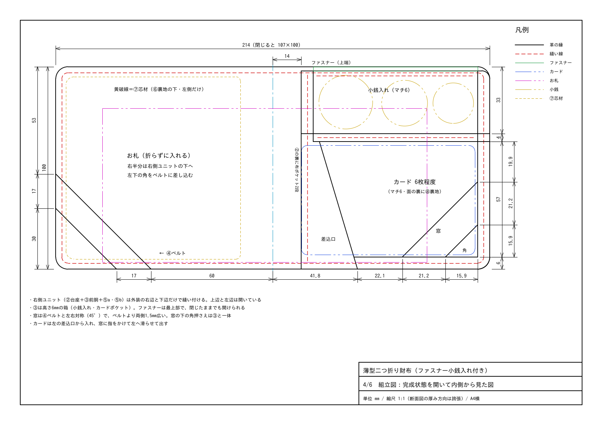

# 薄型二つ折り財布（立体ポケット＋上部ファスナー小銭入れ）設計図

ラフスケッチと右側の型紙イメージをもとに寸法を決めた、レザークラフト用の設計図です。Jw_cad で開いて編集できる DXF 形式で、**A4横・実寸（1:1）の6枚**に分けています。

## 完成イメージ（CG）

設計寸法から3Dモデルを作り、Blender（Cycles）で描いたイメージです。写真ではありません。革の色・糸・布の色は一例です。お札は参考のための図柄なしの紙です。

| 開いた状態 | 右側ユニットの寄り | 閉じた状態（上端のファスナー） |
|---|---|---|
|  |  |  |

## ファイル

| ページ | DXF（`dxf/` フォルダ） | 内容 |
|---|---|---|
| 1/6 | `wallet_A4_1_pattern_body.dxf` | 型紙：①外装（⑥裏地・⑦芯材の切り線入り） |
| 2/6 | `wallet_A4_2_pattern_front_base.dxf` | 型紙：③前胴（立体の展開図・⑧裏地の切り線入り）、②台座 |
| 3/6 | `wallet_A4_3_pattern_pockets_band.dxf` | 型紙：⑤a・⑤b 裏ポケット布、④札押さえベルト、部品表、裏地の貼り方 |
| 4/6 | `wallet_A4_4_assembly_inside.dxf` | 組立図：完成状態を開いて内側から見た図 |
| 5/6 | `wallet_A4_5_assembly_sections.dxf` | 組立図：断面 A-A／B-B／C-C、閉じた状態を上から見た図 |
| 6/6 | `wallet_A4_6_assembly_notes.dxf` | 組立図：閉じたときの重なり、厚みの内訳、仕様、作り方 |

- `wallet_A4_all.pdf`：6ページをまとめた印刷用PDF（A4横・実寸）。印刷するときは「実際のサイズ（100%）」を選んでください。
- `preview/page1〜6.png`：プレビュー画像。
- `generate_wallet.py`：図面の生成スクリプト（寸法を変えて作り直すとき用）。
- `render/wallet_*.jpg`：完成イメージ（CG）。`render_wallet.py` で `generate_wallet.py` の寸法から作り直せます。

## Jw_cad での開き方

1. Jw_cad の用紙サイズを **A-4**、縮尺を **S=1/1** にする。
2. ［ファイル］→［DXF形式ファイルを開く］で `.dxf` を開く。
3. 縮尺が 1/1 でなければ［設定］→［縮尺・読取］で 1/1（実寸固定）にする。必要なら `.jww` で保存する。

- 形式は AutoCAD R12 の ASCII DXF、文字コードは Shift-JIS。原点 (0,0) は A4 用紙の中心です。
- レイヤ：`切断線` `縫い線` `山折り` `谷折り` `中心線` `貼り位置` `ファスナー` `カード` `お札` `小銭` `芯材・裏地` `寸法` `文字` `断面図` `図枠`
- 型紙のページ（1〜3）は、左下の 100mm スケールで印刷倍率を確認してください。

## 部品と材料

| No. | 部品 | 数 | 素材・厚みの目安 |
|---|---|---|---|
| ① | 外装 | 1 | 牛革 1.0mm（張りのあるもの） |
| ② | 台座（小銭・カードの背面） | 1 | 牛革 0.8mm |
| ③ | 前胴（立体：小銭入れ＋カードポケット＋角押さえ） | 1 | 牛革 0.6〜0.8mm（折りやすい柔らかめの革） |
| ④ | 札押さえベルト | 1 | 牛革 0.8mm |
| ⑤a | 裏ポケット布（奥） | 1 | 布 0.2mm |
| ⑤b | 裏ポケット布（手前） | 1 | 布 0.2mm |
| ⑥ | 裏地（①の内側全面） | 1 | 布 0.2mm |
| ⑦ | 芯材（左側だけ） | 1 | ボンテックス 0.4mm |
| ⑧ | 裏地（③カード面の裏） | 1 | 布 0.2mm |

- 3号コイルファスナー 1本：務歯 81mm（止め金具の間）、テープ長 約92mm。テープは務歯から内側へ 12mm を残してカットする。
- ロウ引き糸 0.45〜0.55mm：約5m。
- ゴム系接着剤、床面処理剤、布のほつれ止め、（あれば）コバ塗料。

## 構造



- **お札**：折らずに入れます（160×76）。左半分は外装の左側に出ていて、左下の角を④ベルトに差し込みます。右半分は右側ユニットの下に入ります（上辺・左辺から差し込む）。
- **外装の内側**：全面に⑥裏地（布）を貼ります。左側（お札側）だけは、外装と裏地の間に⑦芯材を挟んで張りを出します。芯材は中心の折り目と縫い線にはかけません。
- **右側ユニット**（②台座＋③前胴＋⑤a/⑤b）：外装には**右辺と下辺**で縫い付けます。
- **③前胴は立体**：タブ（幅6）を②に縫い付け、壁（高さ6）を手前に折り上げると箱になります。
  - **小銭入れ**：ファスナーは最上部にあります。財布を閉じたままでも開けられます。
  - **カードポケット**：6枚程度入ります。左の差込口から入れ、右下の窓に指をかけて左へ滑らせて出します。カード面の裏には⑧裏地を貼り、カードを滑りやすくします。
  - **窓と角押さえ**：窓は 45° の斜めのくり抜きです。窓の下の角押さえは右タブ・下タブで③とつながっているので、カードが少ないときでも右下が飛び出しません。
- **窓とベルト**：左の④ベルトと右の窓は、中心線に対して対称です。窓はベルトより両側1.5mm広いので、閉じるとベルトが窓に収まります。
- **裏ポケット**：②の裏に布のポケットを2段付けます。上から入れるポケットで、上端は斜め（左が低い）です。
- **厚み**：閉じた状態で約 10〜13mm（中身による）。

## ⑥裏地の貼り方と仕上げ（「0.5mm内側」の意味）

布は革のように縁（コバ）を磨けません。また、縁にそろえると、やすりや磨きのときに毛羽立ちます。そこで、布の端を**革の縁より0.3〜0.5mmだけ内側に下げて**おきます。こうすると、縁を磨くときに布に触れず、横から見ても布の切り口がほとんど見えません。

1. **布を切る**：①の型紙より2〜3mm大きく切るのがおすすめです。型紙の黄色破線（0.5mm内側の線）で切ってもかまいませんが、貼るときに位置がずれやすくなります。
2. **芯材を貼る**：①の床面の左側に⑦芯材を貼ります（黄色の実線の位置）。芯の縁は紙やすりで軽く落とし、段差をなだらかにします。
3. **接着剤を塗る**：①（芯の上も含む）と布の両方に、ゴム系接着剤を薄く均一に塗ります。半乾きになったら、中央から外へ空気を押し出すように貼ります。芯の縁の段差はヘラで押さえて密着させます。
4. **折り目の部分**：①を閉じる方向に軽く曲げた状態で貼ります。平らなまま貼ると、閉じたときに裏地が余ってシワになります。この部分は接着剤を特に薄くします。
5. **切り落とす**：乾いたら①を裏返し、①の縁に沿ってカッターで布を切り落とします。刃を少し内側（布側）に倒して切ると、布が縁より0.3〜0.5mm内側で切れます。
6. **ほつれ止め**：ナイロンやポリエステルなら、切り口をライターやヒートカッターで一瞬あぶって溶かします。綿ならほつれ止め液を塗ります。
7. **縫う**：①と⑥を重ねたまま菱目打ちで穴をあけ、そのまま縫います。布は縫い線の外側に約2.5mm残るので、縫い目でしっかり留まります。
8. **縁の仕上げ**：やすりと磨きは革の縁だけにかけます（布は内側に下がっているので削れません）。コバ塗料で仕上げると、布との段差も目立ちません。

⑤a・⑤b・⑧も同じ要領です。⑤の入口（上端）は、折り返し代6mmを内側（②側）へ折って貼ります。必要なら上端から3mmを押さえ縫いします。

## 主要寸法（mm）

| 項目 | 寸法 |
|---|---|
| 開いたサイズ／閉じたサイズ | 214 × 100 ／ 107 × 100 |
| 外周 | 角 R6、縫い線はコバから 3（菱目 3mm ピッチ） |
| 右側ユニット | 中心から 14 〜 右端。上端は外装より 2 下（ここにファスナー） |
| 小銭入れ（完成） | 内寸 約 79 × 30、高さ（マチ）6、ファスナー務歯 81 |
| カードポケット（完成） | 上端から 37〜94、内寸の縦 約 55.4、高さ（マチ）6 |
| 差込口（③の斜め辺） | ポケット上端で中心から 23、底で 40 |
| ④ベルト（45°） | 側面で上端から 53〜70、下辺で中心から 60〜77（幅 約12） |
| 窓（45°） | 右の壁で上端から 56.9〜78.1、底で中心から 63.9〜85.1（ベルト＋両側1.5） |
| 裏ポケット（斜め） | ⑤a 深さ 左67／右75、⑤b 深さ 左55／右63、内幅 約 86 |
| ⑦芯材 | 左側のみ。縫い線から 2、中心から 16 離す（約 86 × 90） |
| ③前胴の展開サイズ | 105 × 116 |

## 厚みの内訳（閉じた状態・カードポケットの位置）

| 部分 | 厚み |
|---|---|
| ①外装 × 2 | 2.0 |
| ⑥裏地 × 2 | 0.4 |
| ⑦芯材（左） | 0.4 |
| ⑤a・⑤b 裏ポケット布 | 0.4 |
| ②台座 | 0.8 |
| ③の箱（マチ6：面・⑧裏地・カード6枚を含む） | 6.0 |
| **合計（お札1〜2枚）** | **約 10.2** |
| お札10枚程度＋裏ポケットにカード各1枚 | **約 12.5** |

## 作り方の順序

1. 裁断し、床面を処理する。③の折り線（山折り＝一点鎖線、谷折り＝破線）に溝を入れ、窓をくり抜く。自由辺（差込口・窓・④）のコバを先に仕上げる。
2. ①の左側に⑦芯材を貼り、⑥裏地を内側全面に貼る（上の「⑥裏地の貼り方と仕上げ」参照）。
3. ④ベルトを⑥の上に貼る。③のカード面の裏に⑧裏地を貼る。
4. ファスナーを付ける。下側テープを③の上端の裏に、上側テープを②の上端の表に貼り、どちらも上端から 2.5mm の位置で縫う。
5. ③のタブと谷を②に貼り、仕切りの谷（③＋②）を縫う。
6. ③の右タブ・下タブを②に貼る。カードを3枚ほど入れて壁を立てた状態で貼る。
7. ⑤a・⑤b の斜めの上端を折り返して貼る。②の裏に ⑤a→⑤b の順に、縫い代だけを貼る。
8. 左端の縦の線（③左タブ＋②＋⑤a＋⑤b）を上から下まで縫う。これでユニットが完成。
9. 外周を縫う（①＋⑥＋④）。右辺・右下の角・ユニット部分の下辺は残しておく。
10. ユニットを①に重ねて縫い代だけ接着し、下辺→右下の角→右辺を全層まとめて縫う。
11. コバを仕上げる（布は 0.5mm 内側）。最後に中心に折り癖を付ける。

## 布の選び方

| 素材 | 厚み目安 | 特徴 | 端の処理 |
|---|---|---|---|
| **ナイロン**（ツイル・タフタ） | 0.1〜0.3mm | 薄くて丈夫。すべりが良く、カードやお札を出し入れしやすい。財布の裏地の定番 | 熱で軽く溶かして止める |
| **ポリエステル**（ツイル・サテン・ジャカードなど） | 0.1〜0.3mm | ナイロンに近い性質。光沢や柄のあるものが多い | 熱で止められる |
| **綿**（コットンツイル・シーチングなど） | 0.2〜0.5mm | 手に入りやすく、風合いがやわらかい。汚れ・湿気にはやや弱い | ほつれ止め液 |
| **人工スエード**（マイクロファイバーの不織布） | 0.4〜0.8mm | 切りっぱなしでもほつれない。少し厚く、値段は高め | 不要 |

おすすめはナイロンツイル（0.2mm前後）です。⑤⑥⑧をすべて同じ布で作れます。

## 寸法を変えたいとき

`generate_wallet.py` の先頭にある「設計寸法」を書き換えて、次のコマンドで再実行すると、DXF・PDF・PNG がすべて作り直されます。

- 全体：`W`、`H`
- ③の立体：マチ `G`、タブ `T`
- 差込口：`D_TOP_U`、`D_BOT_U`
- 窓とベルト：角度 `K_AB`、窓の余裕 `WIN_CLEAR`、ベルト位置 `A_EDGE_V`・`B_EDGE_V`
- 裏ポケット：斜めの上端 `POCKETS`（左端と右端の高さ）
- 芯材：`CORE_IN`、`CORE_FOLD`

左右の対称と、③の展開図（壁・タブ・窓のくり抜き）は自動で計算されます。

```
pip install matplotlib   # PDF/PNG が必要な場合のみ
python3 generate_wallet.py
```

完成イメージも作り直す場合は、Python 3.11 で Blender の Python モジュールを入れて実行します（CPU で1枚数分）。

```
pip install bpy==4.4.0 "numpy<2"
python3.11 render_wallet.py                  # open / detail / closed の3枚
python3.11 render_wallet.py open --samples 32 --scale 40   # 試し描き
```
