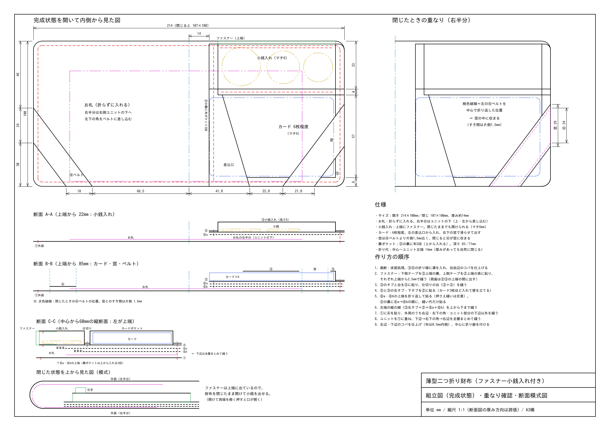

# 薄型二つ折り財布（立体ポケット＋上部ファスナー小銭入れ）設計図

ラフスケッチと右側の型紙イメージをもとに寸法を決めた、レザークラフト用の設計図です。Jw_cad で開いて編集できる DXF 形式です。

## ファイル

| ファイル | 内容 |
|---|---|
| `wallet_pattern_A3.dxf` | **型紙**（実寸 1:1・A3横）：①外装 ②台座 ③前胴（立体の展開図） ④札押さえベルト ⑤カード押さえ（立体） ⑥a/⑥b 裏ポケット布 |
| `wallet_assembly_A3.dxf` | **組立図**：完成状態の内側図、閉じたときの重なり、断面 A-A／B-B／C-C、閉じた状態を上から見た図、仕様、作り方 |
| `wallet_pattern_A3.pdf` / `wallet_assembly_A3.pdf` | 上の2枚の PDF（A3・実寸で印刷可） |
| `preview_pattern.png` / `preview_assembly.png` | プレビュー画像 |
| `generate_wallet.py` | 図面の生成スクリプト（寸法を変えて作り直すとき用） |

## Jw_cad での開き方

1. Jw_cad の用紙サイズを **A-3**、縮尺を **S=1/1** にする。
2. ［ファイル］→［DXF形式ファイルを開く］で `.dxf` を開く。
3. 縮尺が 1/1 でなければ［設定］→［縮尺・読取］で 1/1（実寸固定）にする。必要なら `.jww` で保存する。

- 形式は AutoCAD R12 の ASCII DXF、文字コードは Shift-JIS。原点 (0,0) は A3 用紙の中心です。
- レイヤ：`切断線` `縫い線` `山折り` `谷折り` `中心線` `貼り位置` `ファスナー` `カード` `お札` `小銭` `寸法` `文字` `断面図` `図枠`
- 印刷したら、左下の 100mm スケールで倍率を確認してください。

## 構造



- **お札**：折らずに入れます（160×76）。左半分は外装の左側に出ていて、左下の角を④ベルトに差し込みます。右半分は右側ユニットの下に入ります（上辺・左辺が開いているので、そこから差し込む）。
- **右側ユニット**（②台座＋③前胴＋⑤＋⑥a/⑥b）：外装には**右辺と下辺**で縫い付けます。
- **③前胴は立体**：タブ（幅6）を②に縫い付け、壁（高さ6）を手前に折り上げると箱になります。
  - **小銭入れ**：**ファスナーは最上部**にあり、務歯が②と③の上端の間に出ます。財布を閉じたままでも開けられます。
  - **カードポケット**：6枚程度入ります。差込口（③の左の斜め辺）を左へ伸ばし、カードの隠れる範囲を広げました。右下の窓に指をかけて、左へ滑らせて出します。
- **窓とベルト**：左の④ベルトと右の窓は、中心線に対して対称です。窓はベルトより**片側1.5mm広く**してあるので、多少ずれても閉じたときにベルトが窓に収まります。
- **折り代**：中心からユニットの左端まで 14mm 空けています。厚みが出ても自然に閉じます。
- **裏ポケット**：②の裏に布のポケットを2段付けます。**上から入れる**ポケットで、左辺・右辺・下辺を縫います。⑥a（奥）の上端は上から14mm、⑥b（手前）は26mm で、12mm ずらして重ねています。

## 主要寸法（mm）

| 項目 | 寸法 |
|---|---|
| 開いたサイズ／閉じたサイズ | 214 × 100 ／ 107 × 100（厚み 約14） |
| 外周 | 角 R6、縫い線はコバから 3（菱目 3mm ピッチ） |
| 右側ユニット | 中心から 14 〜 右端。上端は外装より 2 下（ここにファスナー） |
| 小銭入れ（完成） | 内寸 約 79 × 30、高さ（マチ）6、ファスナー務歯 81 |
| 仕切りの谷 | 上端から 33〜37（縫い線 35） |
| カードポケット（完成） | 上端から 37〜94、内寸の縦 約 55.4、高さ（マチ）6 |
| 差込口（③の斜め辺） | ポケット上端で中心から 23、底で 40 |
| ④ベルト | 側面で上端から 46〜70、下辺で中心から 66.5〜84.5（幅 約14.4） |
| 窓 | 側面で 43.5〜72.5、下辺で 64.6〜86.4（ベルト＋片側1.5） |
| 裏ポケット | ⑥a 深さ 83、⑥b 深さ 71、内幅 約 86 |
| ③前胴の展開サイズ | 105 × 116 |

## 部品と材料

| No. | 部品 | 数 | 素材・厚みの目安 |
|---|---|---|---|
| ① | 外装 | 1 | 牛革 1.2〜1.4mm |
| ② | 台座（小銭・カードの背面） | 1 | 牛革 0.8〜1.0mm |
| ③ | 前胴（立体：小銭入れ＋カードポケット） | 1 | 牛革 0.8mm（折りやすい柔らかめの革） |
| ④ | 札押さえベルト | 1 | 牛革 1.0mm |
| ⑤ | カード押さえ（立体） | 1 | 牛革 0.8mm |
| ⑥a | 裏ポケット布（奥） | 1 | 布 0.2〜0.5mm |
| ⑥b | 裏ポケット布（手前） | 1 | 布 0.2〜0.5mm |

- 3号コイルファスナー 1本：務歯 81mm（止め金具の間）、テープ長 約92mm。テープは務歯から内側へ 12mm を残してカットする。
- ロウ引き糸 0.45〜0.55mm：約5m。
- 接着剤（ゴム系）、床面処理剤、布のほつれ止め。

## 裏ポケットの布（裏地）について

財布の内側やカードポケットの裏によく使われる薄い素材には、主に次のようなものがあります。

| 素材 | 厚み目安 | 特徴 | 端の処理 |
|---|---|---|---|
| **ナイロン**（ツイル・タフタ） | 0.1〜0.3mm | 薄くて丈夫。表面がすべるのでカードやお札を出し入れしやすく、水にも強い。財布の裏地の定番 | 切り口はほつれる。ライターやヒートカッターで軽く溶かして止める |
| **ポリエステル**（ツイル・サテン・ジャカードなど） | 0.1〜0.3mm | ナイロンに近い性質。光沢や柄のあるものが多く、裏地に模様を入れたいとき向き | ナイロンと同じく熱で止められる |
| **綿**（コットンツイル・シーチングなど） | 0.2〜0.5mm | 手に入りやすく、風合いがやわらかい。汚れ・湿気にはやや弱い | 熱では止められないので、折り返すか、ほつれ止め液を塗る |
| **人工スエード**（マイクロファイバーの不織布） | 0.4〜0.8mm | 織物ではないので切りっぱなしでもほつれない。手縫いしやすい。少し厚く、値段は高め | 不要（切りっぱなしでOK） |
| 参考：**豚革**（ピッグスキン） | 0.4〜0.6mm | 布ではないが、薄い裏地革の定番。丈夫で切りっぱなしでOK | 不要 |

**今回のおすすめはナイロンツイル（0.2mm前後）**です。薄く仕上がり、ポケットにカードを入れやすくなります。お札もすべり込ませやすくなります（ユニットの下に入れる側）。端の処理を楽にしたい場合は人工スエードも向いています。

扱い方のコツ：

- **入口（上端）**は、型紙の折り返し代 6mm を内側（②側）へ折って貼ります。必要なら、上端から 3mm を押さえ縫いします（ミシンでも手縫いでも可）。
- **左・右・下の端**は、革のコバより 0.5mm 内側に収まるように型紙を作ってあります。縫い代に入る部分は、ほつれ止め（熱で溶かす、またはほつれ止め液）をしておきます。
- **接着**はゴム系接着剤を薄く使います。布に染みやすいので、縫い代だけに付けます。布用の両面テープでも構いません。
- 布は伸びやすいので、②に貼るときは軽く張って、しわが出ないようにします。
- 菱目打ちは革と一緒に打てば布にも穴があきます。

## 作り方の順序

1. 裁断し、床面を処理する。③⑤の折り線（山折り＝一点鎖線、谷折り＝破線）に溝を入れる。組み立て後に磨けない自由辺（差込口・斜辺・④）のコバを先に仕上げる。
2. ファスナーを付ける。下側テープを③の上端の裏に、上側テープを②の上端の表に貼り、どちらも上端から 2.5mm の位置で縫う。
3. ③のタブと谷を②に貼り、仕切りの谷（③＋②）を縫う。
4. ⑤と③の右タブ・下タブを②に貼る。このとき、カードを3枚ほど入れて壁を立てた状態で貼る。
5. ⑥a・⑥b の上端を折り返して貼る（押さえ縫いは任意）。②の裏に ⑥a→⑥b の順に、縫い代だけを貼る。
6. 左端の縦の線（③左タブ＋②＋⑥a＋⑥b）を上から下まで縫う。これでユニットが完成。
7. ①に④を貼り、外周を縫う。ただし、右辺・右下の角・ユニット部分の下辺は残しておく。
8. ユニットを①に重ねて縫い代だけ接着し、下辺→右下の角→右辺を全層まとめて縫う。
9. 右辺と下辺のコバを仕上げる（布は 0.5mm 内側）。最後に中心に折り癖を付ける。

## 寸法を変えたいとき

`generate_wallet.py` の先頭にある「設計寸法」を書き換えて、次のコマンドで再実行すると DXF・PDF・PNG がすべて作り直されます。主な定数は次のとおりです。

- 全体：`W`、`H`
- ③⑤の立体：マチ `G`、タブ `T`
- 差込口：`D_TOP_U`、`D_BOT_U`
- 窓とベルト：窓の余裕 `WIN_CLEAR`、ベルト位置 `A_EDGE_V`・`B_EDGE_V`
- 裏ポケット：上端の位置 `POCKET_TOPS`

左右の対称と、③⑤の展開図（壁とタブの分）は自動で計算されます。

```
pip install matplotlib   # PDF/PNG プレビューが必要な場合のみ
python3 generate_wallet.py
```
